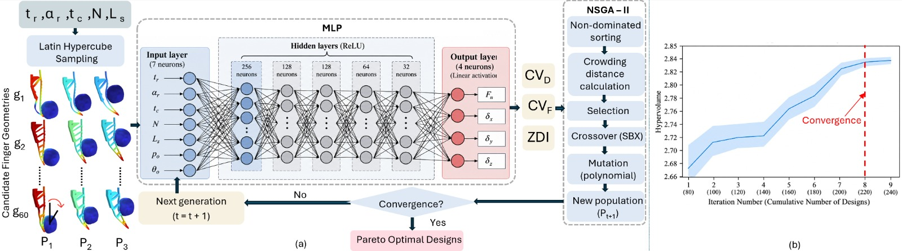
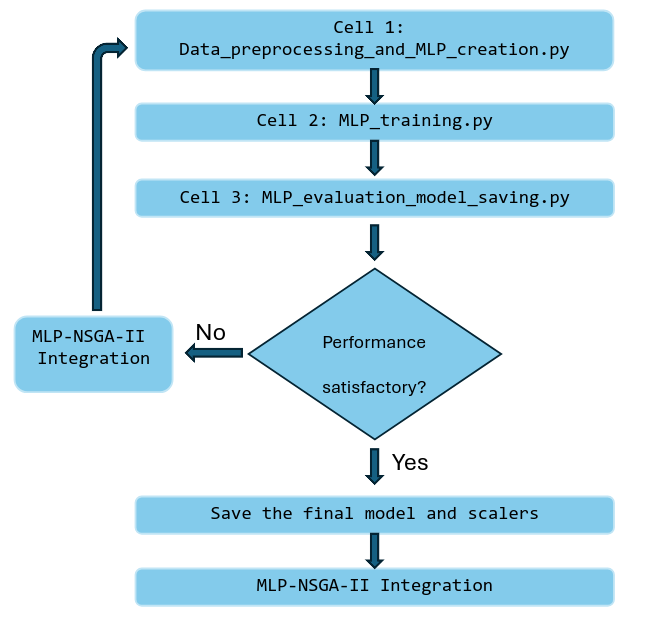
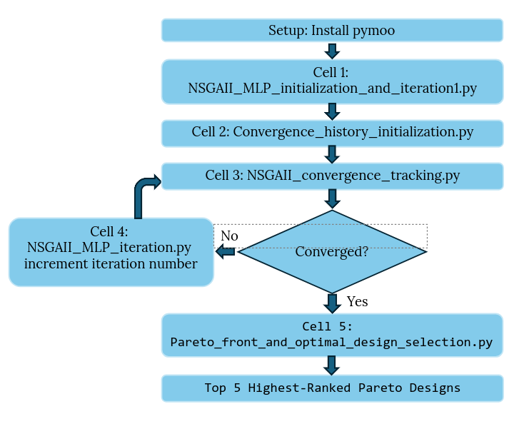

# NSGA-II-and-MLP-Integration

MLP-assisted NSGA-II framework for geometric optimization of the HCA adaptive finger for cluttered waste sorting.

<p align="center">
  
</p>

## Overview

This repository contains the implementation of a **Multi-Layer Perceptron (MLP)-assisted NSGA-II optimization framework** developed for the geometric optimization of an adaptive robotic finger used in the **Hybrid Compliance Activation (HCA) mechanism for cluttered waste sorting**.

The framework integrates a trained MLP model with the **Non-dominated Sorting Genetic Algorithm II (NSGA-II)** to efficiently explore the finger design space while reducing the computational cost associated with repeated finite element simulations.

The implementation consists of two main components:

1. **MLP Model** – developed and trained using finite element simulation data.
2. **NSGA-II Multi-Objective Optimization** – integrates the trained MLP model with NSGA-II for efficient exploration of the finger design space.

---

# MLP Model and Usage

The **Multi-Layer Perceptron (MLP)** model was developed and trained using **Google Colab** with data obtained from finite element simulations (COMSOL). The model learns the relationship between the finger design parameters, contact conditions, and corresponding mechanical responses.

The MLP workflow is implemented using the three Python scripts provided in this repository. These scripts are executed sequentially within the same Google Colab session. Model development is iterative, allowing the MLP configuration to be adjusted, retrained, and re-evaluated until satisfactory predictive performance is achieved.

<p align="center">
  
</p>

## 1. Data Preprocessing and MLP Creation

Copy the contents of [`Data_preprocessing_and_MLP_creation.py`](Data_preprocessing_and_MLP_creation.py) into the **first cell** of the Google Colab notebook and execute it.

This script performs the initial data preparation and model setup, including:

- Uploading and loading the simulation dataset
- Defining the MLP input features and output targets
- Data preprocessing and cleaning
- Splitting the dataset into training, validation, and test sets
- Scaling the input and output data
- Defining and creating the MLP architecture

```python
# Cell 1
# Use the contents of:
# Data_preprocessing_and_MLP_creation.py
```

The MLP configuration parameters are defined at this stage. These parameters can be modified during model tuning, including the network architecture, number and size of hidden layers, learning rate, and other model-related hyperparameters.

## 2. MLP Training

Copy the contents of [`MLP_training.py`](MLP_training.py) into the **second cell** and execute it after completing the data preparation and model creation stage.

```python
# Cell 2
# Use the contents of:
# MLP_training.py
```

This script trains the MLP using the training and validation datasets prepared in the previous cell.

Model development should be performed iteratively. After each training cycle, evaluate the model using the third cell. If further improvement is required, return to the first cell and adjust the relevant model or training parameters, such as:

- Number of hidden layers
- Number of neurons per layer
- Learning rate
- Number of training epochs
- Other model and training hyperparameters

After modifying the parameters, recreate the model and repeat the training process.

> **Note:** Re-executing the model creation step initializes a new MLP. Therefore, the model should be retrained after modifying its architecture or relevant configuration parameters.

## 3. Model Evaluation and Saving

Copy the contents of [`MLP_evaluation_model_saving.py`](MLP_evaluation_model_saving.py) into the **third cell** and execute it after each training cycle.

```python
# Cell 3
# Use the contents of:
# MLP_evaluation_model_saving.py
```

This script is used to evaluate the predictive performance of the trained MLP and visualize its current performance. The evaluation results can then be used to determine whether further hyperparameter tuning and retraining are required.

Repeat the training and evaluation process, as illustrated in the workflow above, until satisfactory predictive performance is achieved.

Once the final model configuration has been selected, the same script can be used to save the **trained MLP model and associated data scalers**.

These saved components allow the trained model to be reloaded without retraining and subsequently used during the **MLP–NSGA-II integration and optimization stage**.

# NSGA-II and MLP Integration

The trained MLP is integrated with a constrained **NSGA-II-based multi-objective optimization framework** to optimize the adaptive Fin-Ray finger geometry. This stage is implemented in a separate **Google Colab** environment.

The optimization considers three objectives:

- Minimize the coefficient of variation of in-plane conformance, $CV_D$
- Minimize the coefficient of variation of contact force, $CV_F$
- Minimize the Z-dispersion index, $ZDI$

subject to the force constraint:

$$
\mu_F \geq 15~\text{N}
$$

where $\mu_F$ represents the mean predicted normal contact force across the considered operating conditions.

The trained MLP and associated scalers generated during the previous stage are loaded and used to evaluate newly generated candidate geometries, avoiding repeated finite element simulations during the optimization process.

## Environment Setup

Create a new **Google Colab** notebook for the NSGA-II optimization stage.

In the **first starting cell**, install `pymoo` using:

```python
!pip install pymoo
```

This command only needs to be executed once at the beginning of the Colab session to set up the required multi-objective optimization environment.

> **Note:** This setup cell is not included as a Python file in the repository. After installing `pymoo`, the remaining five cells use the Python scripts provided in this repository.

The complete workflow is illustrated below.

<p align="center">
  
</p>

## 1. NSGA-II and MLP Initialization — Iteration 1

Copy the contents of [`NSGAII_MLP_initialization_and_iteration1.py`](NSGAII_MLP_initialization_and_iteration1.py) into **Cell 1** and execute it.

```python
# Cell 1
# Use the contents of:
# NSGAII_MLP_initialization_and_iteration1.py
```

This script initializes the complete constrained NSGA-II + MLP optimization framework and performs **Iteration 1**.

During execution, the trained MLP model and its associated input and output scalers are loaded into the Colab environment. The initial finite-element dataset is also loaded and used to construct the starting design population.

The script performs the following main operations:

- Loads the trained MLP model and associated scalers
- Loads the finite-element simulation dataset
- Defines the five finger geometry variables
- Defines the operating/contact conditions
- Defines the three optimization objectives
- Applies the mean-force feasibility constraint
- Constructs the initial constrained Pareto front
- Defines the MLP-based geometry evaluation function
- Defines candidate-generation and duplicate-checking functions
- Generates new candidate geometries
- Evaluates the candidates using the trained MLP
- Adds the newly evaluated designs to the cumulative population
- Updates the constrained Pareto front

Each candidate geometry is evaluated under all considered operating conditions using the trained MLP.

The resulting displacement and force predictions are aggregated to calculate the three objectives:

$$
CV_D,\qquad CV_F,\qquad ZDI
$$

while the predicted mean contact force is used to enforce:

$$
\mu_F \geq 15~\text{N}.
$$

Only designs satisfying this force requirement are considered feasible during constrained non-dominated sorting.

> **Note:** This script performs **Iteration 1** automatically.

---

## 2. Initialize Convergence History

After completing Iteration 1, copy the contents of [`Convergence_history_initialization.py`](Convergence_history_initialization.py) into **Cell 2** and execute it.

```python
# Cell 2
# Use the contents of:
# Convergence_history_initialization.py
```

This script initializes an empty convergence-history table before convergence tracking begins.

The following information is recorded during the optimization:

- Iteration number
- Cumulative number of evaluated designs
- Number of constrained Pareto designs
- Minimum $CV_D$
- Minimum $CV_F$
- Minimum $ZDI$
- Pareto-front hypervolume

This cell should be executed **once after Iteration 1 and before the first convergence evaluation**.

---

## 3. NSGA-II Convergence Tracking

Copy the contents of [`NSGAII_convergence_tracking.py`](NSGAII_convergence_tracking.py) into **Cell 3** and execute it after initializing the convergence history.

```python
# Cell 3
# Use the contents of:
# NSGAII_convergence_tracking.py
```

This script evaluates the performance of the current constrained Pareto front and tracks the progression of the optimization.

The primary convergence indicator is the **hypervolume** of the constrained Pareto front.

During the first execution, a fixed hypervolume reference point is established based on the evaluated objective space. The same reference point is retained throughout all subsequent iterations so that the hypervolume values remain directly comparable.

For each iteration, the script records:

- Current iteration number
- Cumulative number of evaluated designs
- Number of Pareto-optimal designs
- Minimum $CV_D$
- Minimum $CV_F$
- Minimum $ZDI$
- Hypervolume

The convergence history is saved as:

```text
FinRay_Pareto_Convergence_History.csv
```

and the corresponding hypervolume convergence plot is saved as:

```text
Pareto_Hypervolume_Convergence.png
```

The plot presents the Pareto-front hypervolume against the **cumulative number of evaluated designs**, allowing the progression of the optimization to be monitored.

> **Important:** The same hypervolume reference point must be maintained throughout the complete optimization run.

After reviewing the convergence behaviour, proceed to the next iteration if the Pareto front has not yet converged.

---

## 4. Iterative NSGA-II + MLP Optimization

Copy the contents of [`NSGAII_MLP_iteration.py`](NSGAII_MLP_iteration.py) into **Cell 4**.

```python
# Cell 4
# Use the contents of:
# NSGAII_MLP_iteration.py
```

The first execution of this cell should begin with:

```python
iteration_number = 2
```

This script performs one additional constrained NSGA-II + MLP optimization iteration.

During each iteration, the script:

- Generates 20 new candidate geometries
- Evaluates each candidate using the trained MLP
- Predicts the response of each candidate under all operating conditions
- Calculates $CV_D$, $CV_F$, and $ZDI$
- Calculates the mean predicted contact force
- Checks the $\mu_F \geq 15$ N feasibility constraint
- Records feasible and infeasible candidates
- Appends the newly evaluated designs to the cumulative population
- Recalculates the constrained Pareto front

After executing Cell 4, return to **Cell 3** and run the convergence-tracking code again.

If convergence has not yet been reached, increase only the iteration number by one before running Cell 4 again.

For example:

```python
iteration_number = 3
```

followed by:

```python
iteration_number = 4
```

and so forth.

The iterative optimization therefore follows:

```text
Run NSGA-II + MLP iteration
        ↓
Update constrained Pareto front
        ↓
Run convergence tracking
        ↓
Check hypervolume convergence
        ↓
Converged?
   ↓           ↓
  No          Yes
   ↓           ↓
Increment     Final Pareto
iteration     analysis
number
   ↓
Run next iteration
```

Continue alternating between **Cell 4** and **Cell 3** until the Pareto-front hypervolume indicates convergence.

For the optimization performed in this work, convergence was observed at **Iteration 9**.

> **Note:** Iteration 9 represents the convergence point observed for the optimization conducted in this work. Other datasets, design spaces, or optimization configurations may require a different number of iterations.

---

## 5. Final Pareto Front and Optimal Design Selection

Once convergence has been reached, copy the contents of [`Pareto_front_and_optimal_design_selection.py`](Pareto_front_and_optimal_design_selection.py) into **Cell 5** and execute it.

```python
# Cell 5
# Use the contents of:
# Pareto_front_and_optimal_design_selection.py
```

This script performs the final analysis of the converged constrained Pareto front.

First, the final Pareto population is verified to ensure that all Pareto-optimal designs satisfy:

$$
\mu_F \geq 15~\text{N}.
$$

The three minimized objectives,

$$
CV_D,\qquad CV_F,\qquad ZDI,
$$

are then min-max normalized across the final constrained Pareto set.

Because all three objectives are minimized, the normalized utopia point is defined as:

$$\mathbf{f}^{*} = [0,\;0,\;0]$$

For each Pareto-optimal design, the Euclidean distance from its normalized objective vector to the utopia point is calculated.

The designs are then ranked in ascending order of their distance to the utopia point, where a smaller distance represents a more balanced trade-off among the three optimization objectives.

The **five Pareto designs with the smallest utopia distances** are extracted as the five highest-ranked candidate designs.

For each of these five designs, the script reports:

- Finger geometry
- $CV_D$
- $CV_F$
- $ZDI$
- Mean predicted contact force
- Utopia distance
- Predicted contact force across all 12 operating conditions
- Predicted $\delta_x$ across all 12 operating conditions
- Predicted $\delta_y$ across all 12 operating conditions
- Predicted $\delta_z$ across all 12 operating conditions

The final constrained three-objective Pareto front is also visualized in 3D.

The five highest-ranked Pareto designs are identified as:

```text
A → Rank 1
B → Rank 2
C → Rank 3
D → Rank 4
E → Rank 5
```

The resulting Pareto-front figure is saved as:

```text
Final_Constrained_Pareto_Top5_Utopia_Arrows_A_to_E.png
```

These five highest-ranked Pareto-optimal finger geometries can then be carried forward for subsequent simulation and experimental validation.

